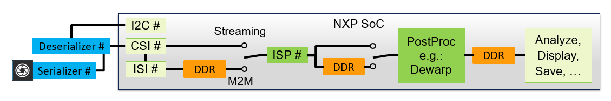
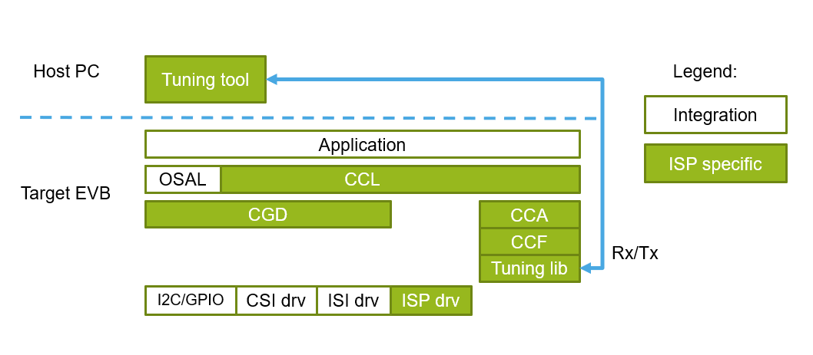
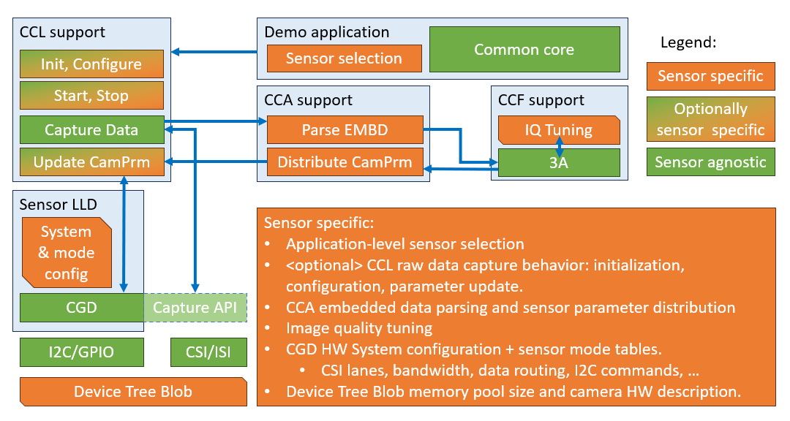
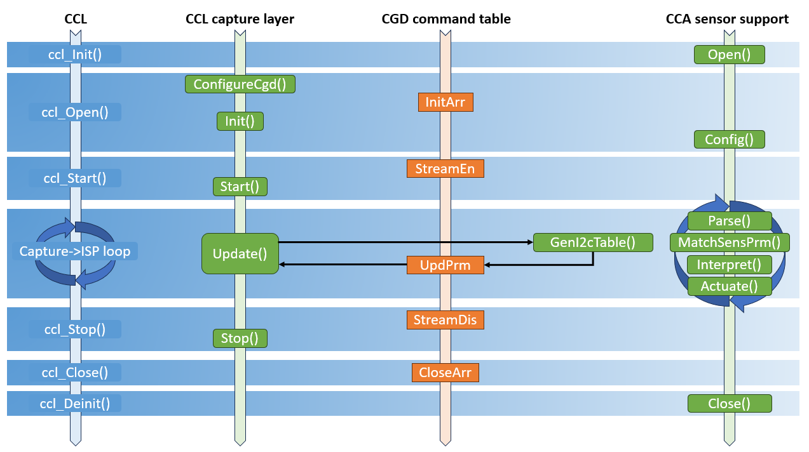

<!--
/*******************************************************************************
 * Copyright 2026 NXP
 * SPDX-License-Identifier: BSD-3-Clause
 ******************************************************************************/
-->
# i.MX 95 ISP SDK Sensor Porting Guide {imx-95-isp-sdk-sensor-porting-guide}

**Document identifier:** IMX95-ISPSDK-SPG

**Revision:** 1.1

**Date:** 19 August 2026

**Company:** NXP Semiconductors

## Introduction

This document describes the steps required to add support for a new RAW image sensor to the i.MX 95 ISP SDK.

### Related documentation

| Document | Description | Link/Access |
|---------|-------------|---------------|
| i.MX 95 ISP SDK Release Notes | Release related information about supported hardware, new features, updates and known bugs | GHS: `isp_sdk/release_notes.txt`<br> MCUX SDK: `neo_isp/RELEASE_NOTES.md` |
| i.MX 95 ISP SDK User Guide | High-level description and usage instructions for the ISP SDK | GHS: `isp_sdk/docs/IMX95_ISPSDK_UG_GHS.md`<br> MCUX SDK: `neo_isp/isp_sdk/docs/IMX95_ISPSDK_UG_MCUX.md` |

---

## i.MX 95 ISP SDK overview

The i.MX 95 ISP SDK is a software development kit that enables use of the ISP pipeline on the i.MX 95 SoC.

### RAW sensor data pipeline

The following figure shows the path of RAW image data from a camera sensor to ISP‑preprocessed, dewarped, or postprocessed image buffers in i.MX 95 memory.



*Figure: i.MX 95 RAW sensor data pipeline*

The sensor device connects directly to the i.MX 95 MIPI‑CSI interface or, as with the Ox03C10 sensor, through a serializer–deserializer pair.

The entry point for the sensor image data (and embedded data) to the i.MX 95 is the MIPI-CSI interface. Sensor control is achieved through I2C.

The ISI module stores CSI‑captured images in DDR in RAW format. The ISP also supports direct streaming from CSI to the ISP; however, this software packages does not support this feature.

The ISP stores output data in DDR memory buffers. From there, the data passes for further processing. For example, dewarping by the 2D blit engine.

### ISP SDK software stack

The following figure shows the ISP SDK software stack. The ISP SDK User Guide briefly describes the components, and the Doxygen generated documentation provides more details.



*Figure: i.MX 95 ISP SDK software stack*

## RAW image sensor porting

This section describes how to add support for a new RAW image sensor to the i.MX 95 ISP SDK.

### Affected software components

Sensor‑specific differences affect several ISP SDK software components, as shown in the following figure:



*Figure: Sensor porting software component impact*

**CameraGenericDriver (CGD)**

The CGD implements a common method for handling a camera sensor over I2C and GPIO. It also provides a unified camera data capture API.

To support a specific camera sensor, configure the CGD by defining the hardware system configuration, including I2C devices, GPIO pins, and CSI and ISI channels.
Define the required I2C register tables for mode initialization, stream enable, and stream disable in the `cgd_SystemExtCfg_t` structure.

**CameraControlAbstraction (CCA)**

The CCA encapsulates the use of Camera Control Functions (CCF, also called 3A) as follows:
* Initializes the CCF processing, including specification of the image quality (IQ) tuning data set.
* Preprocesses CCF input data, including sensor embedded data and ISP‑generated statistics. This includes:
    * **Sensor embedded data parsing**: the embedded data byte array is processed into sensor parameter values (exposure, gains, ...) in the `cca_SensorPrm_t` structure.

    * **Parameter interpretation**: In this process, sensor-specific data is translated into CCF compatible sensor independent CCF inputs.

* Execution of the CCF processing. The behavior is tailored to a specific camera sensor by the IQ tuning setup at initialization of CCF.

* Postprocessing of CCF output data (new sensor and ISP parameter settings). New sensor settings require sensor specific handling:

    * **Parameter distribution**: translation of generic 3A computed new camera sensor settings into a sensor hardware-specific number.

    * **I2C command table generation**: sensor-specific parameters (exposure, gains, ...) are distributed into particular register writes in the I2C command table.

The CCA defines a list of camera operations that must be implemented and related function pointers provided in the `cca_CamOps_t` structure.

On GHS Integrity, the MMS uGuzzi library is used as the CCF library. On MCUX SDK (FreeRTOS), the Neo ISP Control is used.

**CameraControlLibrary (CCL)**

Manages the pipeline from RAW data capture to the ISP output including the CCF execution through CCA calls.

Depending on the execution platform, the CCL can support multiple capture layer implementations using various RAW data capture methods. For example:

* Live data captured from a real sensor operated over CGD.
    * Requires the flexibility to adjust to sensor-specific behaviors. Therefore the process requires a set of operations to be implemented and related function pointers to be provided in the `ccl_CapCfgCgd_t` structure.
* File-based input of precaptured images.
    * The implementation is sensor agnostic.

**Device tree / memory pool**

Depending on the image resolution, pixel format, and required number of buffer sets, the camera image data buffer pool size must be adjusted.

* **Linux / GHS Integrity:** Adjust the memory region pool size in the Device Tree Blob (DTB).
* **MCUX SDK (FreeRTOS):** Adjust the heap block size constants in `isp_sdk/modules/ispdrv_usr/src/freertos/common/mshr.c`. The memory pool is split into blocks for the all streams:

    ```c
    #define MSHR_STREAM_HEAP_BLOCK_SIZE     (100*1024*1024U) // for standard sensors (e.g. OX03C10)
    // OR
    #define MSHR_STREAM_HEAP_BLOCK_SIZE     (250*1024*1024U) // for high-res sensors (e.g. OS08A20 4K)

    DDR_NOINIT uint8_t gHeapLocation[ISP_HWID_CNT * ISPDRV_CAM_PIPE_ID_CNT * MSHR_STREAM_HEAP_BLOCK_SIZE];
    ```

    Camera pipe is assigned from the gHeapLocation; Increase `MSHR_STREAM_HEAP_BLOCK_SIZE` if more memory for high-resolution streams are required.

**Demo application**

The demo application identifies the sensors used as image data sources for each CCL stream and prepares the associated configuration passed to the CCL APIs.

* **GHS Integrity:** The demo uses ini files to configure certain runtime parameters, some of which (for example, IQ tuning data set file) are sensor-specific. The sensor type is specified as a string in the ini file `CAMERA_TYPE`.
* **MCUX SDK (FreeRTOS):** The sensor type is selected at build time via CMake component selection `ispsdk.example.camera_selection`. The selected component sets the `CONFIG_ISP_SDK_CAMERA_TYPE` pre-processor macro, which drives sensor-specific code paths at runtime.

### Porting steps overview

The recommended sequence of steps is listed below:
1. Start from the provided empty template.
2. Configure the CGD system and command tables.
    a. Define the devices controlled by the CGD.
    b. Define required I2C tables (mode initialization, streaming enable/disable) for the sensor operation.
3. Implement the CCL capture layer.
    * Implement functions required by the CGD-based capture method.
    * This step may require modification of the image data buffer pool size (DTB on GHS; `mshr.c` on MCUX SDK).
4. Update the demo application.
    * Adjust the demo code according to the new sensor support requirements.
    * Test with static ISP and camera configuration (CCA disabled).
5. Enable CCA sensor support.
    * Implement functions required by the `cca_CamOps_t` structure.
    * Generate an IQ tuning database.
    * Test the whole setup.


### Porting steps in detail

**1. Start from the template**

1. As a starting point for the new sensor introduction, use the provided template files **new_sensor\_\*.\*_** located in the `inc` and `src` folders of the relevant demo directory:

    | Platform | Template location |
    |----------|-------------------|
    | GHS Integrity | `isp_sdk/apps/demos/ghs/isp_ccl/inc/` and `isp_sdk/apps/demos/ghs/isp_ccl/src/` |
    | MCUX SDK (FreeRTOS) | `isp_sdk/apps/demos/mcux/shared/inc/` and `isp_sdk/apps/demos/mcux/shared/src/` |

    The template files are based on the OX03C10 camera enablement.

2. Choose a short string to identify your new sensor type consistently throughout the application code. The chosen string replaces any occurrence of "new_sensor", "NEW_SENSOR" and “NewSensor” strings in the files mentioned below.

3. Rename the template files by replacing the `new_sensor` with the sensor-specific string chosen in step 2.

4. Ensure that the file renaming is reflected in the build configuration of the **isp_ccl** demo application.

**2. Configure the CGD command tables.**

In **\<new_sensor\>_ccl_i2c.h** / **\<new_sensor\>_ccl_i2c.c**:

1. Specify all relevant sensor HW I2C addresses by modifying the `cgd_NewSensorI2CAddress_t` enumeration.
2. To assign an index number to each of the I2C device related to the new camera hardware, modify the `cgd_NewSensorDeviceI2CId_t` enumeration.
3. Replace the “NewSensor” string by your sensor identification.
4. Implement the predefined I2C command tables:
    * In each command, use the `cgd_NewSensorDeviceI2CId_t` enums as defined in step 2.
    * See `cgd_Cmd_t` and `cgd_CmdIds_t` Doxygen code documentation for more details.
    1. InitArr
        * Initializes a camera sensor hardware by configuring registers over I2C.
        * There can be other devices (serializers, deserializers, and so on) that must be configured.
        * The command is executed once per CSI port and is common to all available cameras on the CSI port.
        * The command is executed inside the `ccl_Open()` after the `cgd_Config()` and before the CCL capture layer `Init()` call.
    2. StreamEn
        * The command enables to start streaming video data from the sensor. Configure the serializer/deserializer pipeline if applicable.
        * The command is executed per each active instance of a camera sensor.
    3. StreamDis
        * Stops streaming video data from the sensor.
        * The command is executed per each active instance of a camera sensor.
    4. CloseArr
        * Moves camera sensor hardware to a state ready for the new initialization sequence.
        * The command is executed once per CSI port and is common to all available cameras on the CSI port.
3. Follow more descriptions in the template and example implementation of OX03C10 camera enablement.
4. Add any custom I2C command tables if needed.

As mentioned in the next section, the CGD command table pointers are assigned to `cgd_CsiExtCfg_t` when initializing the CGD library in the CCL Capture layer.

The figure below shows the execution order of the CGD tables across the CCL API calls, CCL capture layer, and CCA camera operations.


*Figure: Sensor support temporal sequence*

**3. Implement the CCL capture layer.**

In **\<new_sensor\>_ccl.h** / **\<new_sensor\>_ccl.c**:

1. Replace the "new_sensor" string by your sensor type identification.
2. Modify the `sgNewSensorI2cAdrTable` to define the  correspondence between I2C device addresses and the device IDs.
3. Implement the CCL capture layer callbacks:
    1. ConfigureCgd (optional)
        * This callback is called inside `ccl_Open()` before `cgd_Config()` is executed.
        * It allows to modify the system wide default configuration of CSI and ISI modules before being passed to CGD.
          1. Assigns CGD command table pointers.
          2. Defines CSI and ISI parameters in the scope of `cgd_CsiExtCfg_t` and `cgd_IsiExtCfg_t` structures.
          3. Assigns `sgNewSensorI2cAdrTable` address and length to the `cgd_CsiExtCfg_t` structure.
          4. Note that the CSI data type definition is platform specific. For example, it is different for GHS and MCUX SDK.
    2. Init (optional)
        * This callback is called inside `ccl_Open()` after the `cgd_Config()`.
        * It is called after the CGD Init command table was already executed.
        * Allows you to modify the settings for a particular camera hardware once the camera has been initialized.
        * Has access to sensor parameter data if any. This structure is shared with CCA sensor support code as well.
        * In case of OX03C10, the Init call is used to read out OneTimeProgrammable (OTP) data from the sensor.
    3. Start (optional)
        * This callback is called inside the `ccl_Start()`.
        * The CGD StreamOn command table was already executed.
        * Nothing to be done for most sensors.
    4. Update (optional)
        * This callback is called from CCL each time there is a new configuration for the sensor available and a suitable time window has opened (just after frame start on CSI interface).
        * It translates the given sensor parameters into the I2C table and executes it. Sends the parameters to the sensor over I2C.
    5. Stop (optional)
        * Called inside the `ccl_Stop()`.
        * The `CGD StreamDis` command table was already executed.
        * Nothing to be done for most sensors.


**4. Update the demo application.**

The demo application differs per platform:

- **GHS Integrity:**

    In **app_ctx.h**:
    1. Replace the "new_sensor" and “NewSensor” strings by your sensor identification. This impacts:
        * include `\<new_sensor\>.h`
        * Use of `\<new_sensor\>_Params_t` in the `AppCtx_t` structure.

    In **tools.cpp**:
    1. Replace the "NEW_SENSOR" string by your sensor identification.
        * This modifies the `scCameraTypesMap[]`.
        * The corresponding string from the `scCameraTypeMap[]` entry must match the camera type field in the application INI file (setup later in this guide).
    2. Use the `demo_InitCtx()` function to set default values into the `mNewSensorParams` members if needed. Otherwise, it stays cleared to `0`.

    In **main.cpp**: Replace the "new_sensor", "NEW_SENSOR" and “NewSensor” strings by your sensor identification.

    In **\<new_sensor\>.ini**:
    1. Replace the "`NEW_SENSOR`" string by your sensor identification used also in the application defined `scCameraTypeMap[]`.

    2. Update the YAML entry to reference the ISP register settings for the sensor configuration.

    3. Update the VIG, LTM, and GTM_LUT entries with lookup tables appropriate for the sensor configuration. Initially, you can use the default ox03c10 LUTs; however, this configuration results in visible artifacts.

    4. To reflect the image properties of your sensor, modify the EMBD0/1_NUM entries. Expects the embedded data to be part of the image data buffer as the first and/or last lines.

    5. Make sure that the `CCA_ON` is set to `0` to disable the use of the CCA and CCF libraries as it has not been enabled yet.

    6. Keep the dewarping disabled by keeping the DEWARP_MAP empty.

    In **Device Tree Blob**:

    1. Update the memory region pool size dedicated to each of the 8 ISP-supported streams and accommodate all required buffer sets (RAW + output image buffer pairs).
    2. Modify any camera hardware-related configurations such as GPIO and I2C. Follow the OX03C10 example in the `isp_sdk/build/ghs/kernel` directory.


- **MCUX SDK (FreeRTOS):**

    - In **camera_ctx.h**: replace the "NewSensor" string by your sensor type identification.

    - In **camera_task.c**: replace the "NewSensor" string by your sensor type identification.

    - In **CMakeLists.txt**: replace the "NewSensor" string by your sensor type identification.

    - In **display_task.c**: If the new sensor image resolution can exceed the display panel size, ensure that the DPU fetch unit is configured with the full image stride and the visible area is clamped to the panel dimensions. <br> Use `DPU_SetFetchUnitSrcBufferConfig()` with `strideBytes = imgWidth * bytesPerPixel` rather than a simple `DPU_SetFetchUnitSrcBufferAddr()` call.

    At this point, the demo captures RAW sensor images and preprocesses them in the ISP using the default static ISP register configuration from the YAML file (GHS) or binary config (MCUX).

**5. Enable CCA sensor support.**

This section describes how to enable dynamic image quality control by introducing CCA sensor support code.

In **\<new_sensor\>_cca.h**:

1. Make sure the value defined with `\<NEW_SENSOR\>_DTP_ID` matches the sensor ID used in the DTP (Database of Tuning Parameters).
2. \(Optional): Modify the value defined with the `\<NEW_SENSOR\>_ID`.
3. Modify the `new_sensor_Params_t` structure declaration as required according to the new sensor code needs.
    * Instance of this structure is created at the application level and passed to the CCL, which shares it further to the CCL capture layer (`Init()` call) and CCA sensor support code (`Open()` call).
    * Example of use for OX03C10:
        * The structure contains values of One Time Programmable (OTP) values, which can be different for each camera sensor piece.
        * The application sets up default values to be used. For example, if there is file-based input, where there is no sensor to read from.
        * The CCL capture layer `Init()` call updates the structure with the sensor specific values read out over I2C at runtime.
        * The CCA support code uses the values when translating the CCF-generated exposure control settings.

In **\<new_sensor\>_cca_int.h**:
* Used for sensor specific constant declarations that can stay private to the CCA support code.
* If not needed, it can be removed.

In **\<new_sensor\>_cca.c**:
1. Look for a section marked `_CCA SENSOR OPERATIONS_`.
2. Implement the required API functions as specified by the `cca_CamOps_t` structure.
    * Check the comments in the code for more details.
    * Change the rest of the `C` file as needed for the new sensor support.
3. Replace the "new_sensor" string in the `new_sensor_GetOps()` function name by your new sensor identification.
4. Update `cca_\<new_sensor\>_GetOps()` implementation if needed.

**GHS Integrity — INI file:**

In **\<new_sensor\>.ini** (`isp_sdk/apps/demos/ghs/isp_ccl/data/`):
1. In the MMS_DTP entry, provide a relative path specific to the new sensor support.
2. Set the `CCA_ON` entry to `1` to enable use of CCA and uGuzzi libraries.

**MCUX SDK (FreeRTOS) - camera configuration:**
Provide new camera specific content for:
1. The default ISP context in the `camera_cfg.c`.
2. The tuning data set in `camera_tuning_database.c` (generated by the Tuning tool).
3. Replace new tuning and context files in the `CMakeLists.txt` configuration.

At this point, the demo captures RAW sensor images, preprocesses them in the ISP, and executes the CCF to enable dynamic image quality control using the provided tuning database.

### Common issues and solutions

#### Issue: I2C communication failure

**Solution**:
* Check the hardware connections.
* Verify the I2C bus configuration.
* Verify the I2C address mapping in `cgd_config.h`.
* Verify GPIO pins for sensor reset or enable.

#### Issue: No image data

**Solution**:
* Check the MIPI CSI‑2 configuration, including lane count, bit rate, and data type.
* Verify the sensor initialization sequence.
* Check that the frame‑done interrupt triggers.
* Verify the error registers on the i.MX 95 platform (check the `cgd_RegisterErrorTable_t` structure).

## Acronyms

| Term | Description |
|------|-------------|
| 3A | Collection of camera image quality automatic control algorithms: usually refers to a set of AEC, AWB, AF but does not exclude other algorithms to be included |
| AEC | Auto Exposure Control |
| AWB | Auto White Balance |
| AF | Auto Focus |
| CCA | Camera Control Abstraction library |
| CCF | Camera Control Functions library, also know as 3A |
| CCL | Camera Control Library |
| CGD | Camera Generic Driver |
| CSI | Camera Serial Interface |
| DDR | Double Data Rate Memory |
| DTB | Device Tree Binary |
| GPIO| General-Purpose Input/Output |
| I2C | Inter-Integrated Circuit |
| ISI | Image Sensing Interface |
| IQ | Image Quality |
| ISP | Image Signal Pre-Processing |
|MIPI-CSI|Mobile Industry Processor Interface - Camera Serial Interface|
| SDK | software Development Kit |
| SoC | System on Chip |
| TT | Image quality Tuning Tool |
| uGuzzi | CCF implementation by MMS third-party company |

## Revision history

| Revision | Release Date | Description |
|----------|--------------|-------------|
|   1.0    | 4 May 2026   | Initial content for the first GHS public release isp_sdk_ear_0.1.7 |
|   1.1    | 19 Aug 2026  | Added MCUX SDK (FreeRTOS) platform support, aligned to ISP SDK EAR 0.1.8 |
