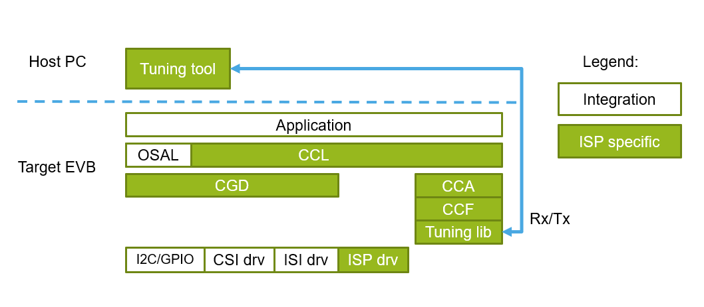
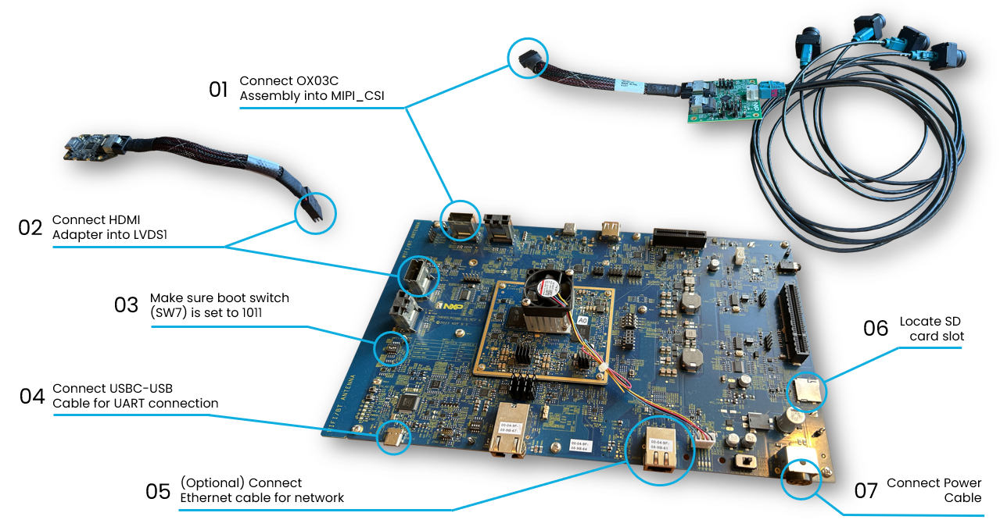

<!--
/*******************************************************************************
 * Copyright 2026 NXP
 * SPDX-License-Identifier: BSD-3-Clause
 ******************************************************************************/
-->
# i.MX 95 ISP SDK User Guide {imx-95-isp-sdk-user-guide}

**Document identifier:** IMX95-ISPSDK-UG

**Revision:** 1.0

**Date:** 21. August 2026

**Company:** NXP Semiconductors


## Introduction

This document contains instructions for i.MX 95 ISP SDK use including installation, build, and execution of the demo application.

### Related documentation

| Document | Description | Link/Access |
|---------|-------------|---------------|
| i.MX 95 ISP SDK Release Notes | Release related information about supported hardware, new features, updates, and known limitations | `neo_isp/RELEASE_NOTES.md` |
| i.MX 95 ISP SDK Sensor Porting Guide | Camera sensor porting guide | `neo_isp/isp_sdk/docs/IMX95_ISPSDK_SPG.md` |

---

## Overview

The i.MX 95 Image Signal Processing (ISP) SDK is a software development kit that enables the use of the NXP ISP pipeline available on the i.MX 95 SoC.

### Components

The ISP SDK software stack diagram below illustrates the software components included in the ISP SDK.


*Figure: i.MX 95 ISP SDK software stack*

- Low-level drivers for register configuration and IRQ handling:
    * **I2C and GPIO** - RAW camera configuration and control.
    * **CSI and ISI** - camera RAW data capture.
    * **ISP** - raw data processing and ISP task scheduling.
- Middleware components:
    * **Camera Generic Driver (CGD)**
        * Camera control over I2C and GPIO.
        * Data capture via CSI/ISI.
    * **Camera Control Functions (CCF)**
        * Provides 3A algorithms (AEC, AWB, AF) and other camera and ISP control functions.
        * CCF is a generic placeholder for any particular 3A implementation available in this ISP SDK version.
    * **Camera Control Abstraction (CCA)**
        * Abstracts and integrates the use of particular CCF library.
        * Abstracts vendor-specific camera sensor controls.
    * **Camera Control Library (CCL)**
        * Implements API for higher software integration including application development.
        * Encapsulates the complete camera pipeline from sensor control through RAW data capture to ISP processing and 3A (CCF) execution.
        * Builds on top of the above-mentioned components.
        * Provides buffer and event handling services. API for camera and ISP control.
        * Introduces an abstraction layer (OSAL) for required OS-dependent synchronization primitives.
- Demo application:
    * **isp_ccl**
        * Implemented based on the CCL API.
        * Demonstrates supported functionality of the ISP SDK release.

Detailed information about particular software components and available APIs is provided through Doxygen comments in the source code.

### Key features

* OX03C10 camera sensor support with Maxim serializer/deserializer.
* Multicamera supports up to 4 camera streams.
* ISP operation in memory to memory and streaming RAW input mode.
* NXP developed CCF (3A) library, Neo ISP Control version 0.4.0.
* Support for live ISP tuning connection over Ethernet with the NXP developed ISP tuning tool, Neo ISP Tune 0.3.0.
* Camera porting prototype for new camera sensor support introduction.

### Prerequisites

- Hardware:
    * i.MX 95 LPD5 EVK-19 B0 board.
    * Micro SD card bootable media.
    * Set of four OX03C10 cameras with Maxim serializer/deserializer (SerDes).
    * HDMI display connected to i.MX 95 EVK for real-time video output.
    * (optional) Ethernet connection to the Host PC for runtime interaction (live image quality tuning).

- Host PC software development environment:
    * Visual Studio Code.
    * MCUX SDK 26.09 for i.MX 95.
    * (optional) Neo ISP Tune tuning tool (version 0.3.0) on the Host PC for creation and modification of a tuning data set and live tuning interaction.

## i.MX 95 EVK setup

This software release applies to the i.MX 95 LPD5 EVK-19 B0 board. Follow the instructions presented in the image below.


*Figure: i.MX 95 EVK setup*

## Installation procedure

The ISP SDK is fully integrated into the MCUX SDK as a middleware repository.

- To obtain MCUX-SDK see:
[Install SDK](https://docs.mcuxpresso.nxp.com/mcuxsdk/latest/gsd/install/index.html).

- To install all necessary development tools, see:
[Development Tools Installation](https://docs.mcuxpresso.nxp.com/mcuxsdk/latest/gsd/installation.html).

## Folder structure

Once the MCUX SDK is installed, the ISP SDK is located inside the `mcuxsdk/middleware/neo_isp` directory. The folder structure is organized as follows:

* **neo_isp/**
    * **isp_sdk/**
        * **apps/demos/mcux** - This folder contains sources for the `isp_ccl` example application.
        * **build/mcuxsdk** - This folder contains top level CMake and Kconfig configuration files.
        * **doc/**- This folder contains this user guide and sensor porting guide.
        * **modules/**- This folder contains sources of ISP SDK components (drivers, libraries).
        * **scripts/**- This folder contains SD card image generation script.
    * **licenses** - This folder contains involved licenses.

The `isp_ccl example` application located in the `middleware/neo_isp/apps/demos/mcux` folder is integrated with the MCUX SDK build infrastructure over additional directories inside the `mcuxsdk/examples` directory:

* `examples/demos/isp_ccl` - board independent part
* `examples/_boards/imx95lpd5evk19/demo_apps/isp_ccl` - board specific part

## Build

1) Specify the build environment variable:
    ```bash
     export ARMGCC_DIR=/opt/arm-gnu-toolchain-14.3.rel1-x86_64-arm-none-eabi
    ```
2) **Optional:** If using python virtual environment, activate it.
3) Run the `build` command in the `mcuxsdk` directory:
    ```bash
    cd <path_to_mcuxsdk_folder>
    west build examples/demo_apps/isp_ccl --config debug -b imx95lpd5evk19 --toolchain armgcc -p always '-Dcore_id=cm7' -d ../../build_isp_ccl-mcux
    ```
    The resulting application binary is located in `mcuxsdk/../../build_isp_ccl-mcux/isp_ccl_cm7.elf (.bin)`.


### i.MX 95 EVK board deployment {#imx95-evk-board-deployment}

1. Build the application image using the `build_sd_image.v2.sh` in `neo_isp/isp_sdk/scripts` folder.
    * The script decomposes `isp_ccl_cm7.elf` into specific sections for the Cortex-M7 core and compiles the final application image.
    * The script needs the Cortex-M33 bootloader, System Manager, and other images as described in `spsdk_templates`. These images are not part of the ISP SDK middleware.
    * Configure the System Manager image such that the Cortex-M7 core allows to control media domain hardware blocks such as ISP, MIPI, and CSI.

2. Deploy the image to the target EVK using one of the following options:
    a) Flash to the SD card.
    b) Upload over UUU (prerequisite: Bootloader with alternative "System Manager" that allows the Cortex-M7 core to control the SoC; modify SW7 boot switch).
    c) Upload over debugger (prerequisite: bootloader with alternative "System Manager" that allows the Cortex-M7 core to control the SoC).

### Build parameters

The following configurations apply:
1. **"West build" command parameters**:
    * To enable Ethernet stack add:
      ``` bash
          -o=-k0 -DISPSDK_ENABLE_ETH=1
      ```
      For example:
      ``` bash
          west build examples/demo_apps/isp_ccl --config debug -b imx95lpd5evk19 --toolchain armgcc -p always '-Dcore_id=cm7' -d ../../build_isp_ccl-mcux -o=-k0 -DISPSDK_ENABLE_ETH=1
      ```
2. **Project file parameters** (`examples/demo_apps/isp_ccl/prj.conf`):
    * Via menuconfig:
        * New `prj.conf` can be created based on default project configuration generated via menuconfig tool.
        * Execute normal build command and add `-t menuconfig`. For example:
           ``` bash
            west build examples/demo_apps/isp_ccl --config debug -b imx95lpd5evk19 --toolchain armgcc -p always '-Dcore_id=cm7' -d ../../build_isp_ccl-mcux -t menuconfig
           ```
        * Once editing is done, save and exit menuconfig.
        * Copy a new file (the default file location for the given command is `build_isp_ccl-mcux/.config`) to the directory `examples/demo_apps/isp_ccl/prj.conf`.
    * Manual editing of `prj.conf`:
        * The file contains only selected configuration options, the ones that mainly target `isp_ccl` demo features.
        * You can simply comment or uncomment various features.
3. **Default ISP configuration**: the initial ISP configuration is defined in the `camera_cfg.c` file under the `middleware/neo_isp/isp_sdk/apps/demos/mcux/shared/src` folder. Modify the parameters as required.
4. **Camera tuning database**: the Camera tuning database is stored in `camera_tuning_database.c` file under
    the `middleware/neo_isp/isp_sdk/apps/demos/mcux/shared/src` folder.

## ISP CCL demo application

The `isp_ccl` example application demonstrates usage of the CCL API for setup and handling of the RAW image sensor pipeline that includes RAW image data preprocessing by the NXP ISP hardware.

### Supported platforms

i.MX 95 LPD5 EVK-19 B0

### Supported camera sensors

The demo application supports one to four ox03c10 cameras with Maxim deserializer.

### Build

Refer to the section [Build](#build).

### Runtime setup

Refer to the section [i.MX 95 EVK board deployment](#imx95-evk-board-deployment).

## Supported demo application parameters

The `isp_ccl` example application can be parameterized through settings in `prj.conf` (`examples/demo_apps/isp_ccl`). Other more detailed settings can be adjust directly in the source code of the `camera_task.c` file.

Specific features that can be configured:

- Enable or disable USB connection support.
- Enable or disable Ethernet support.
- Select the camera sensor type. Only **ox03c10** is available by default.
- Choose **stdout direction**:
    * It is set "to UART" by default.
    * Can be redirected "to USB" for higher bandwidth requirements.
- Set the number of cameras to be used: 1 to 4.
- Select the ISP capture mode:
    * memory-to-memory: In this mode, the ISP reads RAW image data from DDR.
    * streaming: In this mode, the ISP receives RAW image data directly from MIPI CSI over pixel link.
- CCF selection: Use the Neo ISP control library or an empty template for custom implementation.
- Enable or disable live tuning for the case of Neo ISP control CCF library.

### Live tuning

The Neo ISP control library supports live tuning of ISP parameters through a live tuning tool connection over the Ethernet. This allows real-time adjustment of image processing parameters without recompiling the application.

Follow the steps below, before attempting to connect to the Tuning tool from the Host PC:

- Enable live tuning and Ethernet transport connection in `prj.conf`:

  ```
    CONFIG_MCUX_COMPONENT_middleware.ispsdk.ccf.lt=y
    CONFIG_MCUX_COMPONENT_middleware.ispsdk.ccf.lt.transport.eth=y
  ```
- Note: To activate Ethernet, you also need to add the `-DISPSDK_ENABLE_ETH=1` option to the `west build` command.
- Make sure that the `isp_ccl` application is running on the target.

## Acronyms

The table below lists the acronyms used in this document.

| Term | Description |
|------|-------------|
| 3A | Collection of camera image quality automatic control algorithms: usually refers to a set of AEC, AWB, AF, but other algorithms are typically included as well |
| AEC | Auto Exposure Control |
| AF | Auto Focus |
| API | Application Programming Interface |
| AWB | Auto White Balance |
| CCA | Camera Control Abstraction library |
| CCF | Camera Control Functions library, also known as 3A |
| CCL | Camera Control Library |
| CGD | Camera Generic Driver |
| CSI | Camera Serial Interface |
| DDR | Double Data Rate (memory) |
| EVK | Evaluation Kit |
| FPS | Frames Per Second |
| GPIO | General-Purpose Input/Output |
| HDMI | High-Definition Multimedia Interface |
| HW  | Hardware |
| I2C | Inter-Integrated Circuit |
| IRQ | Interrupt Request |
| ISI | Image Sensing Interface |
| ISP | Image Signal Processor |
| MIPI | Mobile Industry Processor Interface |
| OSAL | Operating System Abstraction Layer |
| SDK | Software Development Kit |
| SoC | System on Chip |
| UART | Universal Asynchronous Receiver-Transmitter |
| USB | Universal Serial Bus |
| UUU | Universal Update Utility |

## Revision history

| Document ID | Release Date | Description |
|--------------------------|----------------|-------------|
| IMX95-ISPSDK-UG v.1.0    | 20 August 2026 | Initial content for the first MCUX SDK support release isp_sdk_ear_0.1.8 |
